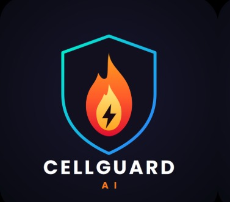
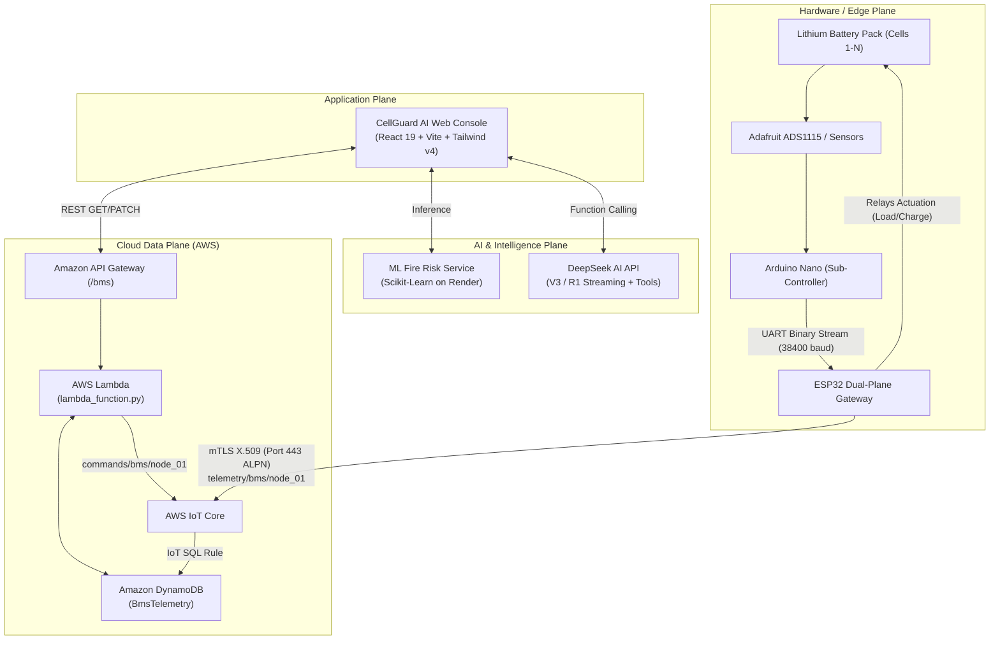

# CellGuard AI

<div align="center">
  
  <p><strong>Next-Generation Cloud-Connected Battery Management System (BMS) with Edge-to-Cloud Telemetry, Remote Actuation & AI-Driven Safety Intelligence</strong></p>

  [](https://react.dev/)
  [](https://vitejs.dev/)
  [](https://tailwindcss.com/)
  [](https://aws.amazon.com/iot-core/)
  [](https://www.espressif.com/)
  [](https://www.deepseek.com/)
  [](LICENSE)
</div>

---

## Overview

**CellGuard AI** is an industrial-grade, full-stack Battery Management System (BMS) platform that bridges edge embedded hardware with cloud analytics and conversational AI.

Built for electric vehicles (EVs), grid energy storage systems (BESS), and lithium-ion battery packs, CellGuard AI provides real-time multi-cell voltage tracking, thermal runaway risk prediction, deterministic fault handling, cloud-to-hardware bidirectional relay actuation over MQTT, and an integrated DeepSeek-powered AI assistant with live BMS function-calling capabilities.

---

## Key Features

### Real-Time Telemetry and Monitoring
- **Cell-Level Voltage Monitoring**: Individual cell monitoring (up to 16 cells, with dynamic auto-detection for 3S packs and beyond), tracking min/max cell voltages and real-time voltage delta ($\Delta V$).
- **Pack-Level Metrics**: Instantaneous voltage ($V$), current ($A$), net power ($W$), State of Charge ($\text{SOC}\%$) via Coulomb counting, and State of Health ($\text{SOH}\%$).
- **Thermal Mapping**: Multi-probe thermal sensing array detecting temperature hotspots and gradient spikes.

### Remote Actuation and Safety Relays
- **Bidirectional Control**: Direct cloud-to-firmware actuation toggling external **Load Contactor** and **Charger Relay** via AWS IoT Core MQTT commands.
- **Fault Latching and Reset**: 16-bit deterministic hardware fault flags (Over-Voltage, Under-Voltage, Over-Current, Over-Temperature, Under-Temperature). Remote clearing with cloud ACK verification.

### AI Fire-Risk Prediction and Heuristics
- **Thermal Runaway Classifier**: Cloud-hosted Machine Learning model assessing multi-variate battery conditions (temperature gradients, voltage drop, internal resistance trends) to score fire risk (`SAFE`, `WARNING`, `DANGER`).
- **Edge Heuristics**: Local risk calculation assessing real-time cell imbalance and high C-rate stress.

### Embedded AI Assistant (CellGuard Copilot)
- **DeepSeek Integration**: Supports `deepseek-chat` (V3) and `deepseek-reasoner` (R1) with OpenAI-compatible streaming.
- **Real-Time Function Calling**: The assistant autonomously queries live telemetry, decodes fault flags, inspects historical trends, and executes actuation commands with operator confirmation.
- **Client-Side Security**: DeepSeek API keys are stored exclusively in `sessionStorage` (never persisted to disk or databases).

### Historical Analytics and Automated Reporting
- **Interactive Graphs**: Recharts-powered telemetry trends across 1-hour, 6-hour, 24-hour, and 7-day intervals.
- **Automated PDF and CSV Reports**: One-click professional BMS health reports generated directly in the browser via `jsPDF` and `jspdf-autotable`.

### Modern UI and Theme Switcher
- **Themes**: Pure OLED Black (`#000000`), Deep Midnight Navy, and High-Contrast Light Mode.
- **Responsive Layout**: Designed with Tailwind CSS v4, Lucide icons, glassmorphism panels, and KaTeX mathematical rendering.

---

## System Architecture



---

## Repository Structure

```
CellGuard-AI/
├── AWS Lambda/              # Serverless AWS Lambda API handler (DynamoDB & IoT MQTT dispatch)
│   └── lambda_function.py
├── ESP32_test_aws/          # PlatformIO embedded C++ firmware for ESP32 gateway
│   ├── include/
│   ├── src/
│   │   └── main.cpp         # Dual-plane (UART + AWS IoT MQTT client)
│   └── platformio.ini
├── public/                  # Static assets & brand icons
│   ├── cellguard.jpeg       # CellGuard AI official logo
│   └── favicon.svg
├── src/                     # React 19 Frontend application
│   ├── components/          # Reusable UI widgets & telemetry panels
│   │   ├── AiPanel.jsx      # AI Fire-risk model card
│   │   ├── Assistant.jsx    # DeepSeek streaming copilot chat dialog
│   │   ├── CellsPanel.jsx   # Individual cell voltage monitor
│   │   ├── ControlPanel.jsx # Contactor / Relay actuation switches
│   │   ├── FaultsPanel.jsx  # Decoded 16-bit hardware fault bitmask
│   │   ├── Header.jsx       # Global system status bar & clock
│   │   ├── Sidebar.jsx      # Navigation & brand identity
│   │   └── ui.jsx           # Cards, Pills, Stats, and Badges
│   ├── context/             # React Context providers (Device & Telemetry)
│   ├── hooks/               # Custom hooks (useTelemetry, useCommand, useAssistant)
│   ├── layouts/             # Main dashboard shell layout
│   ├── lib/                 # Core utilities
│   │   ├── api.js           # AWS API Gateway client & payload normalizer
│   │   ├── deepseek.js      # DeepSeek tool-calling streaming loop
│   │   ├── faults.js        # Bitwise BMS fault flag decoder
│   │   ├── risk.js          # Heuristic safety & risk index calculator
│   │   └── theme.js         # Multi-theme state manager
│   ├── pages/               # Dashboard views
│   │   ├── Dashboard.jsx    # Primary command center
│   │   ├── LiveMonitor.jsx  # Real-time high-rate telemetry
│   │   ├── Analytics.jsx    # Battery state & capacity analytics
│   │   ├── AiPrediction.jsx # Machine learning fire risk analysis
│   │   ├── Alerts.jsx       # Safety anomalies & warning logs
│   │   ├── History.jsx      # Telemetry logs & historical charts
│   │   ├── Reports.jsx      # PDF & CSV generation engine
│   │   └── Settings.jsx     # Device ID, Polling rates, Themes, API keys
│   ├── App.jsx              # React Router setup
│   ├── index.css            # Tailwind CSS v4 variables & theme definitions
│   └── main.jsx             # React DOM root entry
├── package.json             # NPM dependencies & scripts
├── vite.config.js           # Vite configuration
└── README.md
```

---

## Tech Stack

| Domain | Technologies |
|---|---|
| **Frontend Framework** | [React 19](https://react.dev/), [Vite 8](https://vitejs.dev/), [React Router 7](https://reactrouter.com/) |
| **Styling & Design** | [Tailwind CSS v4](https://tailwindcss.com/), [Lucide React](https://lucide.dev/), [KaTeX](https://katex.org/) |
| **Data Visualization** | [Recharts](https://recharts.org/), `react-gauge-component` |
| **Document Generation** | [jsPDF](https://github.com/parallax/jsPDF), `jspdf-autotable` |
| **AI & LLM** | [DeepSeek API](https://platform.deepseek.com/) (Tool-use / Function calling), Scikit-Learn |
| **Cloud Backend** | [AWS IoT Core](https://aws.amazon.com/iot-core/), [AWS Lambda](https://aws.amazon.com/lambda/), [Amazon DynamoDB](https://aws.amazon.com/dynamodb/), [Amazon API Gateway](https://aws.amazon.com/api-gateway/) |
| **Hardware & Firmware**| [ESP32](https://www.espressif.com/), [Arduino Nano](https://store.arduino.cc/products/arduino-nano), [PlatformIO](https://platformio.org/), [PubSubClient](https://github.com/knolleary/pubsubclient), [ArduinoJson](https://arduinojson.org/) |

---

## Telemetry Data Model

Telemetry published from the ESP32 node into AWS IoT Core and stored in Amazon DynamoDB follows this normalized structure:

```json
{
  "device_id": "NANO_ESP_BMS_NODE_01",
  "timestamp": "1787495090372",
  "analysis": {
    "is_safe": true,
    "anomalies": []
  },
  "telemetry": {
    "node_id": "node_01",
    "pack_voltage": 12.41,
    "pack_current": -2.40,
    "pack_power": -29.78,
    "soc": 78,
    "remaining_capacity": 3.9,
    "cell_voltage": [4.15, 4.12, 4.14],
    "temperature": [20, 20, 20],
    "cycle_count": 42,
    "fault_flags": 0,
    "charging": false,
    "load_detected": true,
    "charger_detected": true,
    "load_relay": true,
    "charger_relay": false,
    "bms_online": true,
    "wifi_online": true,
    "aws_online": true
  }
}
```

---

## Getting Started

### Prerequisites

- **Node.js**: v18.0.0 or higher
- **npm** or **yarn** / **pnpm**
- *(Optional for firmware)*: [VS Code](https://code.visualstudio.com/) with the [PlatformIO](https://platformio.org/) extension

### Installation

1. **Clone the repository**:
   ```bash
   git clone https://github.com/your-username/CellGuard-AI.git
   cd CellGuard-AI
   ```

2. **Install frontend dependencies**:
   ```bash
   npm install
   ```

3. **Run the development server**:
   ```bash
   npm run dev
   ```
   Open [http://localhost:5173](http://localhost:5173) in your browser.

4. **Build for production**:
   ```bash
   npm run build
   npm run preview
   ```

---

## Cloud and Firmware Setup

### 1. AWS Lambda and API Gateway
- Deploy `AWS Lambda/lambda_function.py` to an AWS Lambda function running Python 3.11+.
- Attach an IAM role with:
  - `dynamodb:Query`, `dynamodb:GetItem`, `dynamodb:DeleteItem` on the `BmsTelemetry` DynamoDB table.
  - `iot:Publish` on `arn:aws:iot:<region>:<account-id>:topic/commands/bms/*`.
- Configure an Amazon API Gateway HTTP or REST API with route `/bms` forwarding `GET`, `PATCH`, `DELETE`, and `OPTIONS` to the Lambda function.

### 2. ESP32 Firmware
- Open `ESP32_test_aws` in PlatformIO.
- Place your AWS IoT X.509 device certificate, private key, and Amazon Root CA 1 in the credential headers or secure storage.
- Update Wi-Fi SSID and Password in `ESP32_test_aws/src/main.cpp`.
- Build and flash to your ESP32 board over USB:
  ```bash
  pio run --target upload
  ```

---

## Fault Flags Reference

CellGuard AI decodes hardware fault bitmasks into readable alerts:

| Bit | Hex | Fault Code | Description |
|---|---|---|---|
| 0 | `0x0001` | `CELL_OV` | Single cell over-voltage limit reached |
| 1 | `0x0002` | `CELL_UV` | Single cell under-voltage limit reached |
| 2 | `0x0004` | `PACK_OV` | Total pack over-voltage threshold exceeded |
| 3 | `0x0008` | `PACK_UV` | Total pack under-voltage critical cutoff |
| 4 | `0x0010` | `CHARGE_OC` | Over-current detected during charging |
| 5 | `0x0020` | `DISCHARGE_OC`| Over-current detected during discharge |
| 6 | `0x0040` | `CHARGE_OT` | Over-temperature cutoff while charging |
| 7 | `0x0080` | `DISCHARGE_OT`| Over-temperature cutoff during discharge |

---

## License

This project is licensed under the MIT License — see the [LICENSE](LICENSE) file for details.
